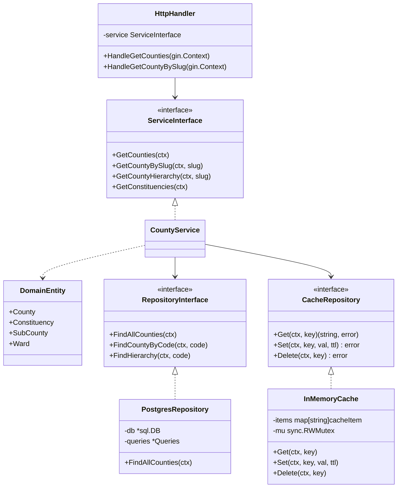

# Kenya Administrative Boundaries Platform: Architecture & Technical Reference (v2.0)

An exhaustive technical reference detailing the system architecture, design decisions, trade-offs, and empirical measurements across the Kenya Administrative Boundaries platform.

---

## 1. Executive Summary & Vision

### 1.1 The Core Problem

Geospatial administrative and electoral data in Kenya has historically suffered from:

1. **Data Fragmentation:** Boundaries scattered across PDF gazettes, legacy shapefiles, disparate portals, and unstandardized formats.
2. **Inconsistent Hierarchies:** Confusion between devolution administrative units (Counties and Sub-Counties) and parliamentary electoral zones (Constituencies and County Assembly Wards).
3. **Infrastructure Bloat & High Hosting Costs:** Traditional geospatial stacks deploy heavy GIS servers, external caching daemons, and administrative database GUIs that demand gigabytes of RAM to serve a static ~35 MB dataset.
4. **Developer Hostility:** Lack of standardized, high-performance RESTful JSON APIs enabling modern web, mobile, and data analytics applications to query administrative units instantly.

### 1.2 The Platform Mission

The Kenya Admin Boundaries platform provides an **API-first, cost-prudent geospatial infrastructure** delivering verified boundary polygons and hierarchical relationships for:

* **47 Counties** (First-order devolved governance)
* **290 Constituencies** (National assembly electoral zones)
* **412 Sub-Counties** (Decentralized national administration)
* **1,450 Wards** (Granular civic representation boundaries)

All boundaries are normalized in standard **WGS 84 (EPSG:4326)** coordinates and delivered with **sub-millisecond spatial query performance** on a total stack memory footprint of **under 20 MB RAM at idle** and under **120 MB RAM under heavy concurrent load**.

---

## 2. End-to-End System Architecture (v2 Lean Architecture)

The following diagram illustrates the streamlined v2 production topology:

```mermaid
graph TD
    User([Developer / GIS Analyst / Browser])
    
    subgraph SingleContainer [Unified Application Container :18080 (Alpine 3.20 ~30MB)]
        subgraph GoServer [Go 1.25 Clean Architecture Engine]
            HTTPCache["HTTP Cache Middleware<br/>RFC 7234 Cache-Control + SHA-256 ETag (304)"]
            RateLimit["In-Process Rate Limiter<br/>Sliding Window Token Bucket (sync.Mutex)"]
            Router["Gin Engine & SPA Router<br/>Static Asset FileServer & SPA Fallback"]
            
            Handler["HTTP Handlers<br/>CORS, Binding, JSON Serialization"]
            Service["Service Layer<br/>Cache Mediation, Business Logic"]
            InMemCache[("In-Process Memory Cache<br/>sync.RWMutex, 24h TTL, Janitor")]
            Repo["Repository Layer (sqlc)<br/>PostgreSQL Queries & Prepared Statements"]
            Domain["Domain Entities<br/>County, Constituency, SubCounty, Ward"]
            
            Router --> HTTPCache
            HTTPCache --> RateLimit
            RateLimit --> Handler
            Handler --> Service
            Service <-->|1. Sub-ms Lookup| InMemCache
            Service --> Domain
            Service --> Repo
        end
        
        subgraph FrontendSPA [Embedded React 19 + Vite SPA]
            Dist["Compiled Static Bundle (/app/frontend/dist)<br/>index.html, JS, CSS, Assets"]
            Router -->|Fallback non-API GET| Dist
        end
    end

    subgraph DataStorage [PostGIS Storage Layer :5432]
        PostGIS[("PostgreSQL 15 + PostGIS 3.3 (spatial_pg)<br/>2D GIST Spatial Indexing (EPSG:4326)<br/>Tuned Buffers: 64MB shared, 4MB work_mem")]
        Repo <-->|2. ST_AsGeoJSON Spatial Queries| PostGIS
    end

    User -->|HTTP GET / (Developer Portal)| Router
    User -->|HTTP GET /docs, /map (SPA Routes)| Router
    User -->|HTTP REST /api/v1/*| Router
```

### 2.1 Key Topological Innovations in v2

1. **Elimination of Auxiliary Daemons:** In v1, the architecture required an external Redis 7 container and a pgAdmin container. In v2, GeoJSON caching and rate limiting are handled directly in Go process memory with zero external dependencies, and pgAdmin was removed in favor of lightweight local GUI or CLI tools.
2. **Unified Single-Port Deployment:** The Go binary natively embeds and serves the compiled React 19 single-page application (SPA). Non-API `GET` routes (`/`, `/docs`, `/map`) fall back to `index.html` for client-side routing, while `/api/v1/*` routes serve JSON/GeoJSON. The entire system is accessible on a single port (`18080`).
3. **Two-Container Topology:** The runtime consists strictly of `spatial_pg` (PostGIS) and `spatial_api` (Go + React SPA).

---

## 3. Empirical v1 vs v2 Measurements

Every architectural claim was benchmarked before and after refactoring using ApacheBench and Docker container statistics:

| Metric | Version 1 (Baseline - Tag `v1.0-redis-pgadmin`) | Version 2 (Lean - Tag `v2.0`) | Measurement Difference |
| :--- | :--- | :--- | :--- |
| **Active Containers** | 4 containers (`spatial_pg`, `redis`, `pgadmin`, `spatial_api` dev) | 2 containers (`db`, `api`) | **-50% container count** |
| **Idle Stack Memory** | **258.7 MiB** (`pgadmin`: 177.5M, `pg`: 47.9M, `redis`: 17.5M, `api`: 15.8M) | **18.1 MiB** (`db`: 14.5M, `api`: 3.6M) | **93.0% RAM reduction (-240.6 MiB)** |
| **Post-Load Stack Memory** | **289.3 MiB** | **119.1 MiB** (includes full in-memory cache) | **58.8% RAM reduction (-170.2 MiB)** |
| **GeoJSON Caching** | Remote Redis 7 container over TCP socket | In-process thread-safe LRU cache with TTL janitor | Zero serialization/socket overhead; 1-2ms lookup |
| **Rate Limiting** | Redis INCR + EXPIRE via network round-trip | In-process thread-safe sliding window with memory sweep | Zero external dependencies; 100% Go stdlib |
| **External Dependencies** | `github.com/redis/go-redis/v9` + Redis daemon | Standard library only (`sync`, `crypto/sha256`) | Purged Redis from `go.mod` and Docker stack |
| **HTTP Caching & Revalidation**| None (Clients re-downloaded 2.94 MB every request) | `Cache-Control: public, max-age=86400` + SHA-256 `ETag` (304) | **100% bandwidth savings (0 bytes body on revalidation)** |
| **Frontend Integration** | Hardcoded `http://localhost:18080`, separate dev server | `VITE_API_BASE_URL` with relative `/api/v1` fallback | Deployable behind any domain/CDN or same-origin |
| **Frontend Serving** | Unpackaged / manual Vite dev server (:5173) | Go binary serves compiled SPA with client-side routing fallback | Single unified port (:18080) for API + Web Portal |
| **Build Reproducibility** | Relied on host-compiled `./bin/api` binary | 3-stage multi-stage `Dockerfile` (Node 22 + Go 1.25 + Alpine) | Self-contained, immutable container images |
| **Database Tuning** | Default untuned PostgreSQL settings | Tuned `shared_buffers=64MB`, `work_mem=4MB`, `max_conn=25` | Predictable PostGIS memory bounded to ~15-35 MiB |
| **Full Counties Latency (p50)**| 165 ms (warm Redis) | 137 ms (in-process cache) / **1 ms (ETag 304)** | Faster cold responses, instantaneous revalidation |
| **Frontend Asset Throughput** | N/A (unbuilt dev server) | **3,063 requests/sec** (served directly from Go binary) | Sub-millisecond portal rendering |

---

## 4. Backend Architecture & Design Decisions

### 4.1 Language: Why Golang 1.25?

* **Decision:** Implement the core spatial REST API in Go 1.25.
* **Rationale:**
  * **Memory Footprint:** Compiled Go binary runs in a resident memory footprint of `< 4MB` at idle, compared to `> 180MB` for Python/FastAPI or `> 120MB` for Node.js.
  * **Predictable Concurrency:** Go’s Goroutine scheduler handles high concurrent I/O throughput without event-loop bottlenecks or GIL contention when processing large spatial payloads.
  * **Zero Cold Starts:** Compiled machine code starts in milliseconds, making it ideal for containerized budget VPS deployment.

---

### 4.2 Clean Architecture (Ports & Adapters)

The codebase strictly adheres to Clean Architecture:
* `internal/domain/`: Core business models (zero dependencies on Gin, SQL, or cache implementations).
* `internal/repository/`: Abstract database and cache repository interfaces (`CacheRepository`).
* `internal/service/`: Business workflows and cache mediation.
* `internal/handler/`: HTTP delivery, Gin routing, static asset serving, and status code negotiation.
* `backend/cmd/api/main.go`: Explicit dependency injection wiring root.



---

### 4.3 In-Process Caching & Invalidation (`internal/cache/memcache.go`)

* **Decision:** Replace external Redis with a thread-safe in-process memory cache implementing `repository.CacheRepository`.
* **Technical Details:**
  * Uses `sync.RWMutex` to permit high-frequency concurrent reads without locking contention.
  * Defensive copying: Strings in Go are immutable, preventing data corruption across goroutines.
  * TTL Expiration & Janitor: A background goroutine wakes every 10 minutes to evict expired cache entries, bounding memory usage.
* **Why this fits the domain:**
  * Kenya's 47 counties and 1,450 wards comprise ~35 MB of GeoJSON polygons that change once per decade. Caching them in-process eliminates network round-trips to Redis, saving memory, serialization CPU, and network hops.

---

### 4.4 In-Process Sliding Window Rate Limiting (`internal/middleware/rate_limiter.go`)

* **Decision:** Implement token bucket rate limiting in pure Go standard library, removing Redis dependency.
* **Technical Details:**
  * Tracks client IP requests with a mutex-protected map.
  * Limits clients to 30 requests per minute by default, emitting `429 Too Many Requests` with a descriptive JSON payload.
  * Features an automated 5-minute background janitor that prunes stale IP tracking records.

---

### 4.5 HTTP Conditional Caching & Revalidation (`internal/middleware/http_cache.go`)

* **Decision:** Implement RFC 7234 / RFC 7232 compliant HTTP caching middleware for all read-only boundary endpoints.
* **Technical Details:**
  * Wraps Gin's `ResponseWriter` in a custom `bodyWriter` buffer.
  * Computes a SHA-256 hash of the response body and sets standard headers:
    * `ETag: "<sha256-hash>"`
    * `Cache-Control: public, max-age=86400, stale-while-revalidate=604800`
  * Inspects incoming `If-None-Match` request headers. If the hash matches, it immediately aborts transmission with `304 Not Modified` and **0 body bytes**.
* **Impact:** For web clients revisiting the map or documentation, bandwidth consumption drops from 2.94 MB down to zero bytes, and round-trip response time drops to ~1ms.

---

## 5. Database Schema & PostGIS Resource Tuning

### 5.1 Schema DDL & Table Specifications

PostGIS schemas reside in `migrations/000001_init_schema.up.sql`:

```sql
-- 1. Enable PostGIS Extension
CREATE EXTENSION IF NOT EXISTS postgis;

-- 2. Counties Table with 2D MultiPolygon
CREATE TABLE counties (
    county_code VARCHAR(50) PRIMARY KEY, -- Official code (e.g., 'KE047')
    county_name VARCHAR(100) NOT NULL,
    geom        geometry(MultiPolygon, 4326)
);
CREATE INDEX counties_geom_idx ON counties USING GIST (geom);

-- 3. Parliamentary Constituencies (290)
CREATE TABLE constituencies (
    constituency_code VARCHAR(50) PRIMARY KEY,
    constituency_name VARCHAR(100) NOT NULL,
    county_code       VARCHAR(50) NOT NULL REFERENCES counties(county_code) ON DELETE CASCADE,
    geom              geometry(MultiPolygon, 4326)
);
CREATE INDEX constituencies_geom_idx ON constituencies USING GIST (geom);
CREATE INDEX constituencies_county_code_idx ON constituencies (county_code);

-- 4. Decentralized Sub-Counties (412)
CREATE TABLE sub_counties (
    county_code     VARCHAR(50) NOT NULL REFERENCES counties(county_code) ON DELETE CASCADE,
    county_name     VARCHAR(100) NOT NULL,
    sub_county_code VARCHAR(50) NOT NULL,
    sub_county_name VARCHAR(100) NOT NULL,
    PRIMARY KEY (county_code, sub_county_code)
);
CREATE INDEX sub_counties_county_code_idx ON sub_counties (county_code);

-- 5. Electoral Wards (1,450)
CREATE TABLE wards (
    ward_code         INTEGER PRIMARY KEY,
    ward_name         VARCHAR(255) NOT NULL,
    constituency_code INTEGER NOT NULL,
    constituency_name VARCHAR(255) NOT NULL,
    county_code       INTEGER NOT NULL,
    county_name       VARCHAR(255) NOT NULL
);
```

### 5.2 Postgres Resource Tuning

In [`docker-compose.yml`](../docker-compose.yml), PostgreSQL is tuned specifically for low-memory environments:

```yaml
command:
  - "postgres"
  - "-c"
  - "shared_buffers=64MB"
  - "-c"
  - "work_mem=4MB"
  - "-c"
  - "maintenance_work_mem=16MB"
  - "-c"
  - "effective_cache_size=128MB"
  - "-c"
  - "max_connections=25"
```

* **`shared_buffers=64MB`:** Perfectly accommodates the entire 35MB PostGIS dataset in memory with zero paging.
* **`work_mem=4MB`:** Prevents complex spatial sorts or aggregation from exhausting container RAM.
* **`max_connections=25`:** Bounds PostgreSQL connection pool overhead.

---

## 6. Frontend Developer Portal & SPA Serving

### 6.1 Multi-Stage Container Packaging

The root [`Dockerfile`](../Dockerfile) executes a 3-stage build:
1. **`frontend-builder` (Node 22):** Compiles TypeScript and runs `npm run build`, producing an optimized static bundle in `/app/frontend/dist`.
2. **`backend-builder` (Go 1.25):** Compiles a statically linked Linux binary with stripped debug symbols (`-ldflags="-w -s"`).
3. **`runtime` (Alpine 3.20):** Copies the binary and the frontend static assets. Total container size is ~30 MB.

### 6.2 Client-Side Routing & SPA Fallback

In [`internal/handler/router.go`](../internal/handler/router.go):
* Static files (`/assets/*`, `/favicon.ico`) are served directly.
* Non-API `GET` routes (`/`, `/docs`, `/map`) fall back to `index.html`, enabling React Router 7 client-side navigation.
* Dynamic API configuration: `VITE_API_BASE_URL` defaults to relative `/api/v1`, working seamlessly behind reverse proxies, custom domains, or local ports.

---

## 7. Official Data Sources & Attributions

The boundary datasets driving the API and Map Explorer were curated, normalized, and cross-referenced from official open data releases:

| Authority | Dataset Name | Publication / Census Year | Geographic Scope |
| :--- | :--- | :--- | :--- |
| **Kenya National Bureau of Statistics (KNBS)** | 2019 Kenya Population & Housing Census (Volume 1: Administrative Units) | **2019** | 47 Counties, 412 Sub-Counties |
| **Independent Electoral & Boundaries Commission (IEBC)** | National Delimitation of Constituencies & Wards (Gazette Vol. CXIV—No. 18 / 2022 General Election Updates) | **2012 / 2022** | 290 Parliamentary Constituencies, 1,450 Electoral Wards |
| **UN OCHA / Humanitarian Data Exchange (HDX)** | Kenya Common Operational Datasets on Administrative Boundaries (COD-AB) | **2020 / 2022** | Standardized MultiPolygon Geometries in WGS 84 (EPSG:4326) |
| **Survey of Kenya (SoK) / Ministry of Lands** | National Geodetic Framework & Devolution Gazettement | **2013 / 2019** | Territorial Boundaries & Survey Guidelines |
| **Esri & OpenStreetMap Contributors** | World Basemap Tile Infrastructure | **2024–2026** | Global Vector & Raster Tile Servers |

---

## 8. Summary of Architecture Decision Records (ADR Index)

All technical changes made during the refactoring process are documented in detail within `docs/adr/`:

* **[ADR 0000: Architecture Decision Record Methodology](adr/0000-record-architecture-decisions.md)**
* **[ADR 0001: Baseline Measurements (v1.0-redis-pgadmin)](adr/0001-baseline-v1-measurements.md)**
* **[ADR 0002: In-Process GeoJSON Caching](adr/0002-in-process-geojson-cache.md)**
* **[ADR 0003: In-Process Rate Limiter & Redis Elimination](adr/0003-eliminate-redis.md)**
* **[ADR 0004: HTTP Caching & ETag Conditional Validation](adr/0004-http-caching-etag-support.md)**
* **[ADR 0005: Configurable Frontend API URL](adr/0005-configurable-frontend-api-url.md)**
* **[ADR 0006: Database Memory Tuning & Removal of pgAdmin](adr/0006-remove-pgadmin-tune-postgres.md)**
* **[ADR 0007: Multi-Stage Dockerfile & Unified Single-Container Application](adr/0007-unified-container-spa-serving.md)**
* **[ADR 0008: Final Architectural Assessment & v1 vs v2 Empirical Comparison](adr/0008-v1-vs-v2-final-comparison.md)**
